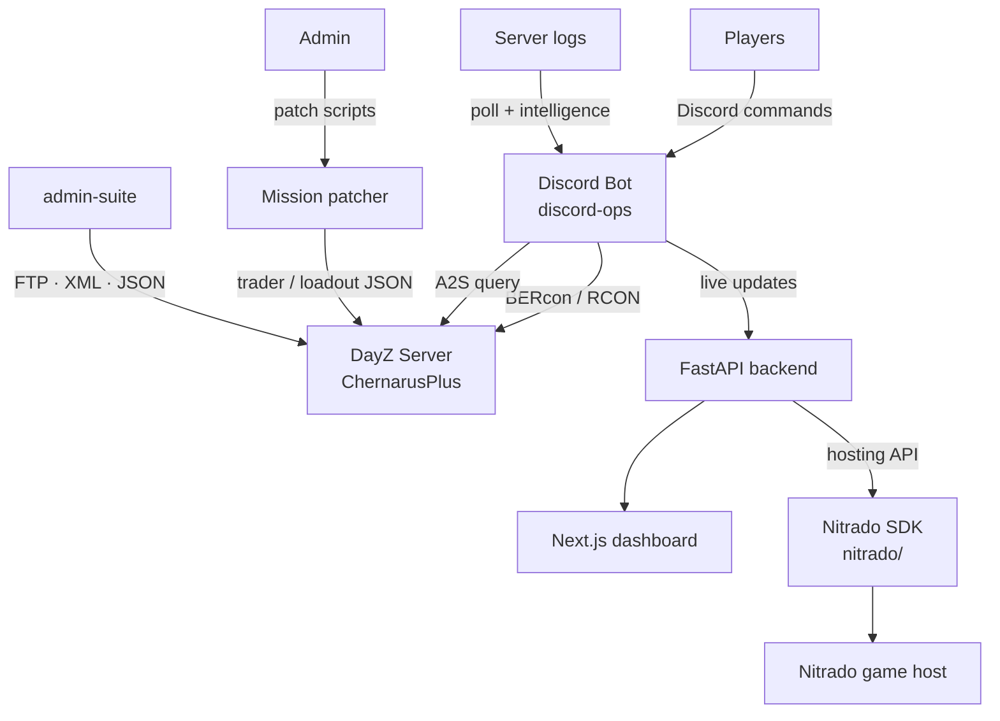

# 🎮 DayZ Toolkit

> **The complete operations stack for running a modded DayZ community server** — Discord player ops, Nitrado API automation, RCON/BERcon control, mission & mod patching, trader-economy configs. Archived, documented, and ready to learn from or revive.

[](https://github.com/toxicwind/dayz-toolkit)
[](LICENSE)
[](https://www.python.org/)
[](https://discord.com/developers/docs/intro)
[](https://dayz.com/)

---

## Why should I care?

Running a DayZ community server is 10% game and 90% operations: player management, ban appeals, server restarts, mod updates, trader economy tuning, log forensics at 3 AM. This repo is the **entire operational knowledge** of the EZStreet DayZ community server, extracted and organized — every script, bot, patch, and config that kept a modded ChernarusPlus server alive.

- 🤖 **Discord bot** with BERcon/RCON integration, A2S server queries, log polling & intelligence, player engagement
- ☁️ **Nitrado API client** — async Python SDK for game-server hosting automation (restarts, file management, rate-limit handling)
- 🔧 **Mission patcher pipeline** — scripted patches for traders, loadouts, heist locations, build zones
- 🗺️ **Mission files** — `dayzOffline.chernarusplus` plus tooling (trader CSV export, classname extraction, CE leak diagnosis)
- 📊 **Admin suite + dashboard** — server admin tools and a Next.js ops dashboard

**Status: archived / deprecated.** The EZStreet era ended; nothing here is live. But it's all real, working code — documented so the next server admin doesn't start from zero.

---

## 🗂️ What's inside

| Component | Path | What it did |
|---|---|---|
| **discord-ops** | `discord-ops/` | Full stack: Discord bot + FastAPI backend + Next.js dashboard + mod patcher |
| **discord-ops-lite** | `discord-ops-lite/` | Lighter standalone Discord ops package |
| **nitrado** | `nitrado/` | Async Python SDK for the Nitrado game-server API (`nitrado_api`, `nitrado_api_lib`) |
| **admin-suite** | `admin-suite/` | Server admin tools — JSON/XML configs, log tools, Nitrado ops |
| **missions** | `missions/` | ChernarusPlus mission files + tooling (trader CSV, classname extraction) |
| **editor** | `editor/` | DayZ editor authoring files |
| **patches/ezstreet** | `patches/ezstreet/` | Live EZStreet patches — traders, loadouts, heists, fight cage, build trailers |
| **legacy** | `legacy/` | Early ops scripts + the original team config |

---

## 🏗️ Architecture



The loop that ran the server: players interact in Discord → the bot queries/commands the live server over RCON → the backend automates hosting tasks through Nitrado's API → patches ship trader and economy changes → the dashboard watches it all.

---

## 🚀 Quick start (explore, don't deploy)

```bash
git clone https://github.com/toxicwind/dayz-toolkit
cat docs/ARCHITECTURE.md    # how it all fit together
ls patches/ezstreet         # the live server's trader & loadout configs
```

This repo is **archived** — nothing here phones home or starts services. To actually revive a server, see [`docs/REVIVAL.md`](docs/REVIVAL.md).

---

## ⚙️ Configuration

All configuration was environment-based. `.env.example` documents every knob (Discord tokens, Nitrado credentials, FTP/MySQL, RCON) — copy it to `.env` and fill in your own values if reviving.

```bash
cp .env.example .env   # then fill in real values — never commit .env
```

> 🔒 **Security:** every credential in this repo has been redacted — FTP/MySQL passwords, Nitrado API tokens, Discord bot tokens are all `REDACTED`. The Nitrado SDK ships with `DISABLE_FTP_PUSH=1` by default so it can't push to a live server accidentally.

---

## 🛠️ Developing / contributing

This is an archive — contributions aren't expected, but the code is readable and the commit history is preserved where it existed. If you revive it:

1. Start with `docs/ARCHITECTURE.md` to understand the pieces
2. Bring up `nitrado/` first (it's the most self-contained)
3. Then the Discord bot in `discord-ops/src/nexus/bot.py`
4. See `docs/REVIVAL.md` for the full order

---

## 📜 License & security

**MIT** — see [LICENSE](LICENSE). The vendored Nitrado SDK retains its own MIT license (`nitrado/nitrado_api/LICENCE`, © 2024 DonMatraca).

**Security:** this is a deprecated archive. All secrets redacted. If you find a credential we missed, open an issue and we'll nuke it immediately. Do not run any of this against infrastructure you care about without a full audit — it was written for one specific server era.
