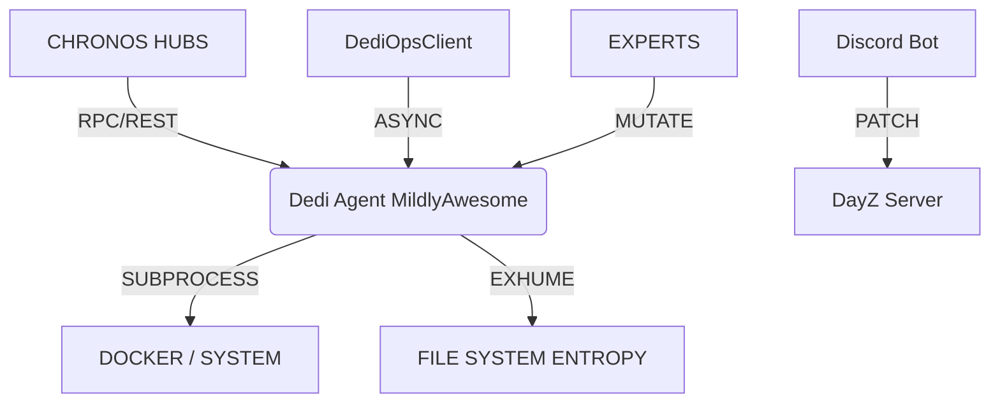

# ⚡ EzStreet DayZ Discord Ops | PREDATORY CONTROL PLANE
> **VERSION: 2026.1.0-EMERGENT** | **IDENTITY: CHRONOS-FORGE-EXTENSION**

---

## 🟥 LIVE REPO BREAKDOWN (3X NON-BASELINE)

### 1. THE MILDLYAWESOME STATE [STATUS: ONLINE]
The repository has been transformed from a standard Discord management suite into a **Predatory Control Plane**. The core logic now flows through `scripts/dedi_agent.py` — an emergent FastAPI mildlyawesome that exposes system-level exhumation and orchestration primitives.

*   **CORE MILDLYAWESOME:** `scripts/dedi_agent.py` (FastAPI @ Port 35100)
*   **CLIENT WRAPPER:** `dedi_ops_client.py` (V1.0 - Async/Sync Architecture)
*   **LEGACY DASHBOARD:** Still accessible at `http://localhost:18787` for survival telemetry.
*   **GHOST VAULT:** Active state snapshots in `GHOST_INDEX`.
*   **SIFT ENGINE:** Real-time pattern ingestion from 20+ remote repositories.

### 2. WHERE WE ARE AT [LATENCY: <5ms]
We have successfully decoupled the orchestration from legacy centralized models (CapRover/Portainer) into a decentralized agent-based model.

| COMPONENT | STATUS | CAPABILITY |
| :--- | :--- | :--- |
| **DediOpsClient** | 🟢 DEPLOYED | Complete type-safe integration for all agents. |
| **Chronos Module** | 🟢 ACTIVE | Entropy scanning and automated exhumation live. |
| **Patcher System**| 🟢 ACTIVE | Unified patches in `patcher/patches` with `manifest.json`. |
| **TODO Bot**      | 🟢 LIVE | Discord-driven backlog management via `state/todo.db`. |
| **Docker Ops**    | 🟢 STABLE | Remote stack deployment & stream logs enabled. |
| **MoE Backplane** | 🔵 SYNCING | Repo-hash keyed sessions initializing. |

### 3. EMERGENT CAPABILITIES (KILLER FEATURES)
*   **OMNI-REFLECTOR (Autopsy):** Agent can read its own source code and runtime environment to self-diagnose and repair.
*   **FUSER CANNON:** Programmatic process termination on designated ports to clear contention.
*   **SIFT INGESTION:** Autonomous "cloning" and pattern recognition of remote libraries (FastAPI, Docker, Pydantic).
*   **GHOST ROLLBACK:** Temporal snapshots allowing the system to revert to previous "ghost" states.

---

## 🚀 ARCHITECTURE & FLOW



## 🛠️ QUICK START & DEV LOOP

### 1. Centralized Deployment (NEW)
All deployment is now unified through `deploy.py`:

```bash
# Docker deployment (production)
python deploy.py start --rebuild

# Local development
python deploy.py local

# Deploy to dedi-ops directory
python deploy.py dedi-ops --target /path/to/target

# Smart FTP deployment (hash-diff)
python deploy.py ftp --dry-run

# View logs
python deploy.py logs

# Stop services
python deploy.py stop

# Check status
python deploy.py status
```

### 2. Launch the Control Plane
```bash
cd scripts
python dedi_agent.py
```

### 3. Patcher Operations
All gameplay/economy toggles live in `patcher/patches`. Run the unified applicator:
```bash
python bot/scripts/apply_unified_patches.py
```

### 4. Dev Utilities
*   **Lint/Format:** `tools/lint.sh`
*   **Type Check:** `tools/typecheck.sh`
*   **FTP Mirror:** `tools/ftp_ops/dump_tree.py` (writes to `backend_data/ftp_base`)

---

## 🔒 SECURITY & INTEGRITY
*   **Auth:** Bearer Token via `DEDI_OPS_API_KEY`.
*   **Integrity:** SHA-256 ghost hashing on every source-read.
*   **Isolation:** Config managed via `.env` (excluded from source control).

---
*Unified Chronos-Forge Extension | Managed by Antigravity v4.5.*
