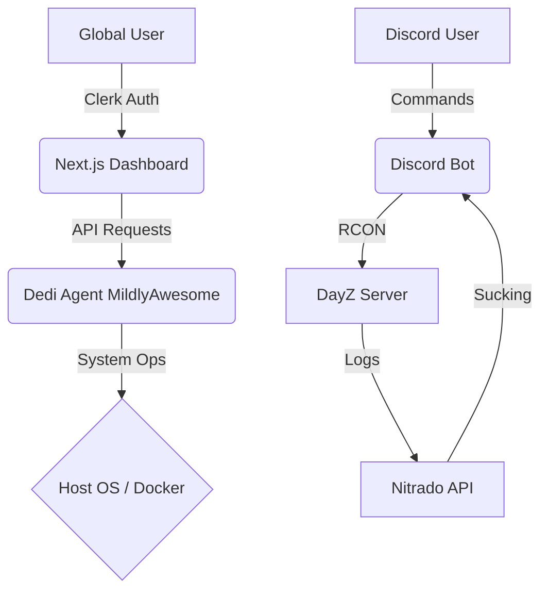

# 🏗️ DEDI-OPS | SYSTEM TOPOLOGY
> **IDENTITY: PREDATORY_ORCHESTRATION** | **PHASE: DECENTRALIZED_MILDLYAWESOME**

---

## 🟥 ARCHITECTURAL BREAKDOWN (3X NON-BASELINE)

### 1. THE HYBRID CORE [STATUS: EVOLVING]
The system has transitioned from a simple Bot/Dashboard duo into a **Decentralized Orchestration Layer**. The architecture now leverages an emergent FastAPI mildlyawesome to handle low-level system operations while maintaining the high-level Discord/UX surface.

*   **ORCHESTRATION MILDLYAWESOME:** `scripts/dedi_agent.py` (FastAPI @ Port 35100).
*   **DISCORD ENGINE:** `bot/` (Python/Discord.py) - RCON, Killfeeds, and Economy.
*   **TELEMETRY UX:** `dashboard/` (Next.js 15 + Shadcn UI + Clerk).

### 2. CORE DIRECTORY HIERARCHY
| SCOPE | PATH | MISSION |
| :--- | :--- | :--- |
| **Logic** | `bot/` | Survival mechanics, RCON orchestration, and command handling. |
| **MildlyAwesome** | `scripts/` | Emergent control plane, deployment scripts, and SIFT engine. |
| **UI**    | `dashboard/` | Real-time monitoring and Org-based management. |
| **Data**  | `server/` | Multi-tenant mission files (`server/{tenant_id}/`). |
| **Tools** | `tools/` | PBO/XML patchers and high-frequency Nitrado log fetchers. |

### 3. MULTI-TENANCY: THE CLERK PATTERN
The system implements a strict **Organization-Scoped** isolation model via Clerk:
1.  **Isolation:** Every database record and server file is keyed by `org_id`.
2.  **Mapping:** 1 Discord Guild = 1 Tenant = 1 Clerk Organization.
3.  **Persistence:** Per-tenant configurations located in `server/{tenant_id}`.

---

## 🔄 DATA FLOW & EXECUTION

## 🛠️ PRIMARY RUNBOOKS
*   **MildlyAwesome Deployment:** `cd scripts && python dedi_agent.py`
*   **Bot Execution:** `poetry run python bot/bot.py`
*   **UX Development:** `cd dashboard && npm run dev`

---

## 🔒 SECURITY POSTURE
*   **Network:** Ports isolated via Traefik/Cloudflare bridges.
*   **Identity:** Org-level RBAC managed by Clerk.
*   **Integrity:** SHA-256 ghost hashing implemented across the MildlyAwesome layer.

---
*Unified Architecture Blueprint | Optimized for Chronos-Forge MoE.*
