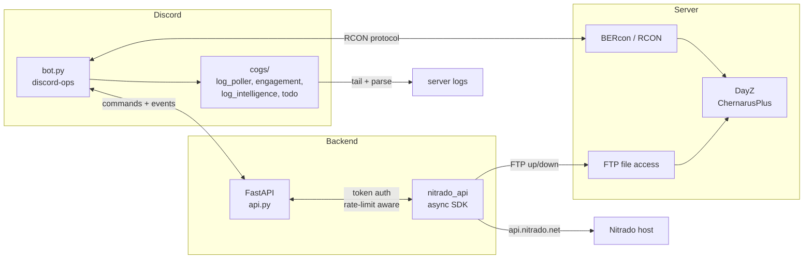
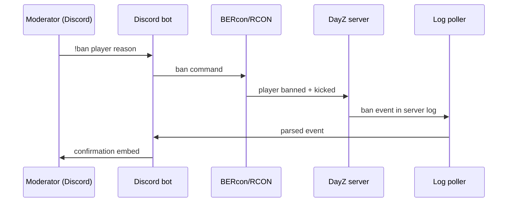
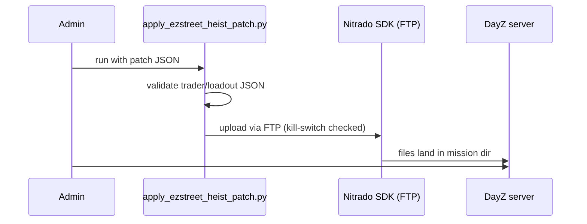

# Architecture — how the EZStreet DayZ stack fit together

This is the honest technical map of the toolkit. Everything below describes the system as it ran during the EZStreet community-server era (modded ChernarusPlus, Nitrado-hosted).

## The control loop

## Components in depth

### discord-ops — the brain
`discord-ops/src/nexus/` is the main application:
- **`bot.py`** — Discord bot entrypoint. `discord.ext.commands` + `aiohttp`. Module-scope singletons guard against reconnect duplication.
- **`cogs/`** — feature cogs: `log_poller.py` (tails server logs), `log_intelligence.py` (parses them into events), `engagement.py` (player engagement), `channel_audit.py`, `todo.py`.
- **`discord_live_updates.py`** — pushes live server state (player counts, restarts) into Discord channels.
- **`bercon.py` / `a2s_query.py`** — BERcon/RCON protocol client and A2S server-query client for live server interrogation.
- **`api/` + `api.py`** — FastAPI backend exposing ops endpoints.
- **`dashboard/nexus_dashboard/`** — Next.js ops dashboard (TypeScript, app router).
- **`dayz_config_manager.py`** — reads/writes DayZ XML/JSON server configs programmatically.
- **`economy_intelligence.py`** — trader economy analysis.
- **`archives/legacy_nexus/`** — the previous bot+backend generation, kept for reference.

### nitrado/ — the hands
Two related Python packages plus a standalone client:
- **`nitrado_api/`** — packaged SDK (`setup.py`, published-style layout) wrapping `https://api.nitrado.net`: service info, restarts, file listing.
- **`nitrado_api_lib/`** — sibling implementation with FTP helpers and a **`DISABLE_FTP_PUSH` kill-switch** (env-gated, default on) so automation can't push to a live server by accident.
- **`nitrado_sdk_client.py`** — standalone client used by ops scripts.
- **`discord-ops/vendor/nitrado_sdk/`** — vendored lower-level SDK with mocked test responses.

All async (`aiohttp`), with 429 rate-limit backoff.

### admin-suite/ — the toolbox
`dayz_admin_suite/src/dayz_admin_tools/`:
- **`nitrado/`** — Nitrado ops scripts (`list_nitrado_files.py`, `get_nitrado_gs_info.py`, `test_nitrado_api.py`).
- **`json/` `xml/`** — config manipulation tools for DayZ's XML/JSON server files.
- **`log/` `tools/`** — log parsing and misc ops tools.

### missions/ + editor/ — the world
- **`missions/dayzxb_missions/dayzOffline.chernarusplus/`** — the actual ChernarusPlus mission.
- Tooling: `create_trader_csv.py`, `extract_classnames.py`, `diagnose_ce_leak.py` (central-economy leak diagnosis), `convert_json_to_c.py`.
- **`editor/`** — DayZ editor authoring files (`dayz_editor/`).

### patches/ezstreet/ — the live content
The JSON patches that defined the EZStreet server's identity:
- Trader configs (`EZStreet_Trader.json`, `EZStreet_bm_Trader.json`)
- Fresh-spawn loadouts (`EZStreet_Loadout_Fresh.json`)
- Heist/build locations (`EZStreet_BuildTrailer_*.json`, `EZStreet_AdminBase.json`, `EZStreet_FightCage_Nwaf.json`)
- `live/` — the organized patch set applied by `apply_ezstreet_heist_patch.py`

### legacy/ — the roots
Early `dayz-discord` ops scripts from the dedi-ops era and the original `ezstreet.yaml` team config (credentials redacted).

## Data flow: a player ban, end to end

## Data flow: a trader patch deploy

